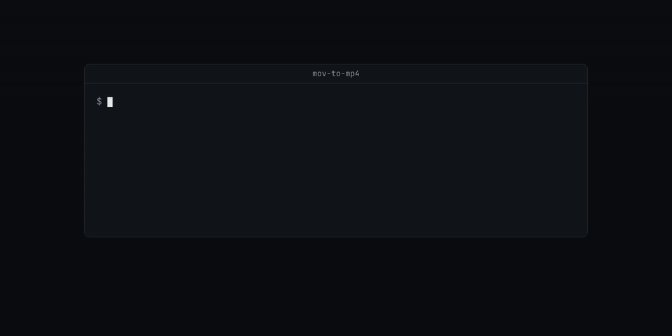

# mov-to-mp4

Turn iPhone .mov files into .mp4 on your phone, without re-encoding.

The H.264 or HEVC video in an iPhone `.mov` already fits in an MP4, so re-encoding only costs time, battery and quality. This Android app copies every packet into an MP4 like `ffmpeg -c copy`, then reads the MP4 back and checks each track's bytes against what it copied. If MP4 can't hold a track (ProRes, say), it tells you and saves nothing.



## Install

No published APK yet. JDK 17 and the Android SDK (platform 35); the phone needs Android 10 or later.

```bash
./gradlew :app:assembleRelease     # app/build/outputs/apk/release/app-release.apk
```

Prebuilt FFmpeg libraries ship in the repo, so no NDK is needed. Without `keystore.properties` the release is signed with your debug key.

## Use

On the phone:

- Open a `.mov` from WhatsApp, Files, Gmail or Drive and pick **Convert to MP4**.
- Or share one or more videos to the app, or pick them inside it.

The MP4 lands in `Movies/MOV to MP4` and shows in the gallery only after verification passes. It keeps rotation, HDR and Dolby Vision tags, spatial video layers, chapters, the creation date and Apple's location keys. It drops Apple's timed-metadata tracks, such as Live Photo markers.

## Limits

- **Not yet run on a device or emulator.** The build, the APK contents and the FFmpeg rebuild were checked; the conversion itself was not.
- MOV in, MP4 out. No re-encoding, trimming or resizing.
- Conversions need free space of the file size plus 32 MB.

Signing, build options and rebuilding FFmpeg from source: [docs/building.md](docs/building.md). How the copy and verify work: [docs/internals.md](docs/internals.md).

## License

The app's code is MIT. It links FFmpeg 8.1.3 built LGPL-only (no GPL or nonfree parts) under the LGPL 2.1 or later; [NOTICE](NOTICE) lists your rights. Anyone distributing a binary built from this repo must pass on NOTICE and the FFmpeg source. [docs/building.md](docs/building.md) has the relink steps.
