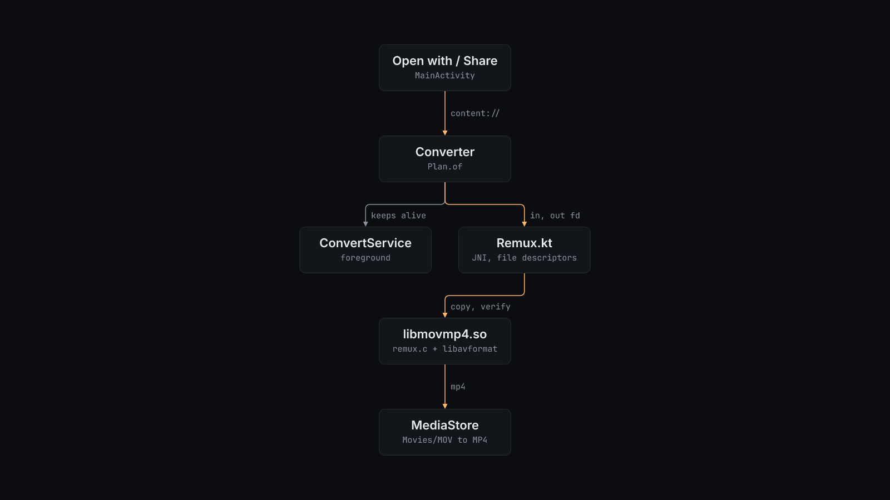

# How mov-to-mp4 works

## How it works

`MainActivity` accepts `VIEW` intents for `video/*`, the QuickTime MIME types and file names ending in `.mov`, `.MOV` or `.qt`, and `SEND` and `SEND_MULTIPLE` from the share sheet. The manifest declares media capabilities so that Android hands over the original HEVC or HDR bytes instead of a transcoded copy.

`Converter` queues the jobs and starts `ConvertService`, a foreground service, so a long file keeps converting in the background. Before it writes anything, `Plan.of` checks the probe result. A file that is already an MP4 and not named `.mov`, an encrypted track, or a picture format MP4 cannot hold stops the job with a plain message. When only the sound cannot be carried, the app offers to save the picture without it. The job also stops when free space is less than the file size plus 32 MB.

`Converter` creates the output through `MediaStore` in `Movies/MOV to MP4` with `IS_PENDING` set, and passes the input and output file descriptors to `Remux.kt`. A `content://` document is never copied to a path first. `native/remux.c` runs in three phases:

1. Copy. libavformat reads every packet from the MOV demuxer and writes it untouched to the MP4 muxer. The stream setup follows `ffmpeg -c copy`, except that every video, audio and subtitle track is carried and the creation time is kept. Each picture and sound track is hashed with MurmurHash3 on the way in.
2. Finish. The muxer writes the MP4 index.
3. Verify. The MP4 is read back and each track is hashed again. If a track's byte count, hash or video sample count differs, the job fails with the numbers.

Only then does `Converter` clear `IS_PENDING`, so the MP4 appears in the gallery.

What the copy carries over:

- The copy keeps rotation, HDR colour tags, Dolby Vision configuration, spatial (MV-HEVC) layers, chapters, timecode, the creation date, and Apple's make, model and location keys.
- It drops Apple's timed-metadata tracks (`mebx`), which hold things like Live Photo markers.
- Samples that an edit list hides are left out, as with `ffmpeg -c copy`. What plays is what is copied.
